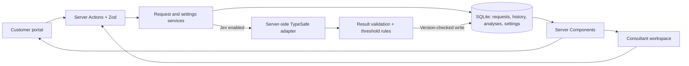

# Link · Jev demo

A local Next.js application for handling an internet provider's support requests. The customer portal and consultant workspace share one SQLite database. The interface, sample requests, and documentation are in English. The implementation follows the [project plan](plan-demo-nextjs-jev.md).

## Run locally

Requires Node.js 22.13+ or 24 LTS and npm. `better-sqlite3` requires the Node.js runtime, not Edge.

```sh
npm ci
cp .env.example .env.local
npm run db:seed
npm run dev
```

Open [http://127.0.0.1:3000](http://127.0.0.1:3000). Seeding is optional. It adds seven sample requests to the manual queue without making API calls. Running it again does not duplicate or delete requests. The seed script loads `.env.local`, just like the application. Keep an existing `.env.local` rather than overwriting your configuration.

- `/customer`: submit requests and view one demo customer's history.
- `/consultant`: review pending, assigned, and spam queues.
- `/consultant/settings`: edit global thresholds, category overrides, and restore defaults.

Open the portals in separate tabs. After a consultant makes a decision, click "Refresh" in the customer portal or return focus to that tab. Handling ends at team assignment; no messages are sent. Dates use English formatting with the existing Europe/Warsaw time zone. Confidence and probabilities use decimal points.

## Two modes

By default, `JEV_ENABLED=false`. No API key is required, the TypeSafe client is not initialized, and new requests wait for a consultant.

To enable real Jev analysis, set the following in `.env.local`:

```dotenv
JEV_ENABLED=true
TYPESAFE_API_KEY=your-api-key
TYPESAFE_DEFAULT_MODEL=jev-1.13.0
DATABASE_PATH=./data/demo.sqlite
```

Restart the server. Changing modes preserves data and settings and does not analyze existing requests. Jev receives the subject and description of each new request. Avoid entering real sensitive information into the demo.

The adapter uses `@typesafe-ai/sdk`, `systemOne`, and a `choice` question. Each analysis has an eight-second limit and no retries. A missing key, timeout, 429, or invalid result leaves the saved request available for manual review. The key, SDK, database, and configuration stay on the server. Provider error details are not exposed in the history or browser.

## Routing rules

| Category                                          | Team                    | Automation          |
| ------------------------------------------------- | ----------------------- | ------------------- |
| Technical issue                                   | IT                      | Both thresholds met |
| Complaint                                         | Complaints              | Both thresholds met |
| Offers and services                               | Marketing               | Both thresholds met |
| Other request                                     | Customer support        | Consultant review   |
| Multiple requests, insufficient information, spam | No automatic assignment | Consultant review   |

Default thresholds are `confidence >= 0.90` and `p1 - p2 >= 0.20`. Equality passes. A category override replaces the global confidence threshold. Confidence describes distribution concentration, not the percentage of correct decisions. The initial thresholds are examples to evaluate on your own requests.

Settings updates are atomic and require the current version. Each analysis uses a snapshot of settings from its start time. Changing thresholds does not alter history or status. The analysis screen can preview current thresholds against a saved result, without an API call or write. Comparison requires compatible question and category versions.

A consultant can correct Jev's assignment. Marking spam is always a manual decision. Restoring a request clears its assignment and returns it to the review queue. Request versions protect against stale forms and late AI results.

## Storage and architecture



Transactions cover request changes and history, never the wait for the API. A submission UUID prevents duplicate requests and analyses; different content with the same UUID produces a conflict. Late analysis remains in history but does not overwrite a consultant's decision. An unfinished attempt is shown as interrupted when read more than eight seconds after it started. It does not block manual decisions.

The database is created automatically at `data/demo.sqlite`. Restarting preserves data. To back it up, stop the server and copy the database along with any WAL/SHM files. This demo runs as one local server with persistent storage. Stateless hosting requires a different storage setup.

There is deliberately no authentication or access control. Anyone who can reach the application can view requests and change decisions or settings. Server scripts bind to `127.0.0.1` by default. Accounts, CRM integration, attachments, replies, SLAs, and production deployment are outside scope.

## Verification

```sh
npm run lint
npm run typecheck
npm test
npm run build
npx playwright install chromium
npm run test:e2e
```

Playwright requires a production build first. It starts two production servers with separate temporary databases and opposite feature-flag values. Jev mode uses the real SDK with a controlled HTTP server at `127.0.0.1:3199`. This transport exists only in tests; there is no mock switch in the application. App servers use ports 3101 and 3102. Test databases are removed when the servers exit.

Unit and integration tests cover threshold boundaries, validation, idempotency, versioning, settings persistence, concurrent consultant decisions, timeouts, transaction rollback, and database migration. Browser tests cover cross-tab assignment updates, spam and restore, stale settings, 429 handling, category overrides and reset, and different decisions for the same result under different thresholds.

Live model quality has not been evaluated. Controlled transport results do not measure Jev's accuracy. For a live evaluation, submit clear, mixed, sparse, and spam requests in English. For several threshold versions, record the expected category, Jev choice, confidence, distribution, decision, and assignment correctness. Model or question changes require a new evaluation.

## Integration references

- [TypeSafe JavaScript SDK](https://docs.typesafe.ai/sdk/javascript)
- [Client configuration and timeout](https://docs.typesafe.ai/sdk/javascript/api/interfaces/TypeSafeClientConfig)
- [Retry policy](https://docs.typesafe.ai/sdk/javascript/api/interfaces/RetryPolicy)
- [Choice](https://docs.typesafe.ai/primitives/choice) and [confidence](https://docs.typesafe.ai/confidence)
- [Next.js Server Actions](https://nextjs.org/docs/app/getting-started/mutating-data)
